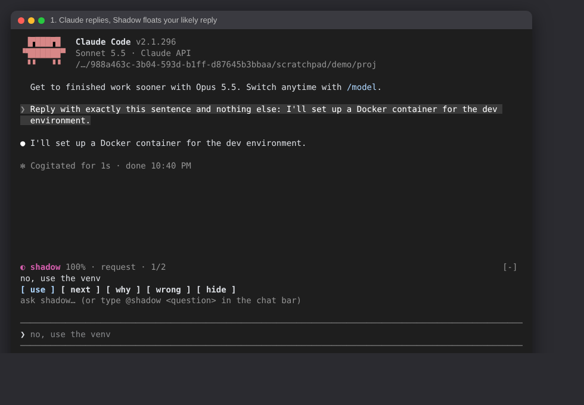
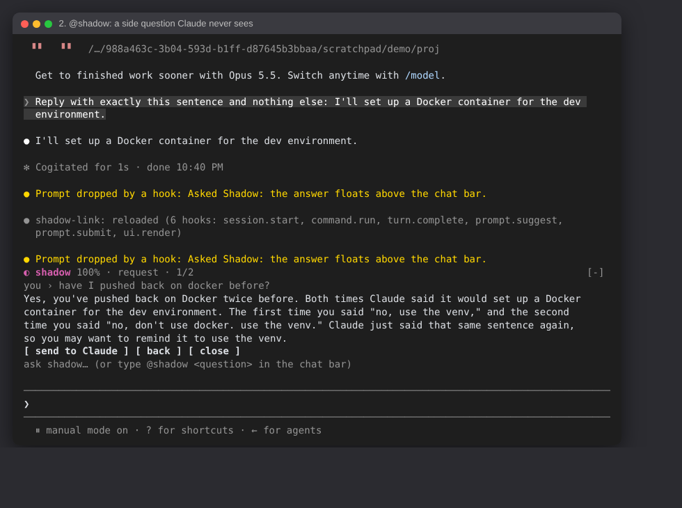

# Shadow Link v3

<p align="center">
  
</p>

<p align="center">
  <strong>The shadow of you.</strong><br>
  Local. Terminal-native. Operator-controlled.<br><br>
  <a href="https://github.com/AIden6464-AI/Shadow-Link-v3">Repository</a> ·
  <a href="https://github.com/AIden6464-AI/Shadow-Link-v3/issues">Issues</a>
</p>

Shadow Link learns how you react to AI coding agents and predicts your next reply. Every time you answer Claude ("no, don't use docker, use the venv"), it stores the pair *what Claude said → what you said back*. The next time Claude says something similar, Shadow shows the reply you'd likely send as a **ghost** you can send with one key.

It runs entirely on your machine: a local daemon and SQLite database, a Claude Code plugin that floats Shadow above the chat bar, a terminal UI, an MCP server, and an optional proxy.

<p align="center">
  
</p>

## Getting started

Requires Python 3.10+ and, for the plugin, Claude Code 2.1.275 or later.

**1. Install Shadow Link**

```powershell
git clone https://github.com/AIden6464-AI/Shadow-Link-v3.git
cd Shadow-Link-v3
python -m venv .venv
.\.venv\Scripts\Activate.ps1
pip install -e .
```

On Windows, if mitmproxy fails to install: `pip install --only-binary :all: mitmproxy`.

**2. Start the daemon** and leave it running:

```powershell
shadow-link daemon
```

**3. Add Shadow to Claude Code.** In Claude Code:

```
/plugin install shadow-link --marketplace AIden6464-AI/Shadow-Link-v3
```

Answer `y` to add the marketplace and pick the user scope. To run the plugin straight from your clone instead, start Claude Code with `claude --plugin-dir plugin`.

**4. Give it some history (optional).** Shadow learns as you work, but you can start it off with your Claude.ai history:

```powershell
shadow-link ingest-claude-export path\to\conversations.json
```

## Shadow in Claude Code

After each Claude reply, Shadow floats above the chat bar with the reply you'd likely send. The same reply appears dimmed inside the chat bar, so **Tab** takes it and **Enter** sends it. While Claude is working, Shadow stays out of the way.

| In Claude Code | What it does |
|---|---|
| Tab, then Enter | Take the ghost from the chat bar and send it. |
| `use` | Put the ghost in the chat bar so you can edit it before sending. |
| `next` | Show the next most likely reply. |
| `why` | Show what in your memory this situation brought back. |
| `wrong` | Tell Shadow the guess was wrong; it weighs that reply less here and shows the next one. |
| `hide` | Hide Shadow; `/shadow` brings it back. |
| `@shadow <question>` | Ask Shadow about the session. Claude never sees it. |
| `/shadow status` | Check the link to the daemon. |

Click the buttons, or focus the floating card with ctrl+x Tab and press `u` `n` `w` `x` `h`.

### Side questions

Type `@shadow` and a question in the chat bar ("have I pushed back on docker before?", "what should I do next?"). Claude Code drops it before Claude sees it, and the answer floats above the chat bar with a **send to Claude** button.

<p align="center">
  
</p>

Shadow answers from the session itself plus your memory in Shadow Link. It reads the session through your own Claude Code login, so there's no separate API key, and the usage counts toward your normal Claude Code usage.

### What it learns

- Every reply you send is saved as a pair with what Claude said before it.
- A ghost you send is reinforced; one you mark `wrong` is weighed down.
- The same reply captured by several paths (plugin, hook, watcher, proxy) is stored once.

### Plugin settings

In `/config`, under shadow-link:

| Setting | Default | |
|---|---|---|
| Daemon URL | `http://localhost:5000` | Where `shadow-link daemon` listens. |
| Minimum ghost confidence | `0.15` | Guesses below this aren't shown. |
| Ghost text in the chat bar | on | Show the ghost dimmed in the chat bar (Tab to take). |

The plugin's code is in [`plugin/`](plugin/).

## How predictions work

1. **Match.** The situation Claude just described is compared with every stored situation by word overlap, and by meaning too when an embedding server is configured.
2. **Weigh.** Each match is scaled by its reply's weight. Weights fade over time unless a reply keeps getting used: corrections and rejections have a 3-day half-life, requests and pivots 7 days, and standing reminders ("always run the tests") never fade. Nothing fades below 25% of its weight; marking a ghost wrong is what removes it.
3. **Show.** The best match becomes the ghost. With a local chat model running, Shadow can instead write a fresh reply in your style, grounded in the matches.

**Associative Context Activation (ACA)** is the memory layer underneath. Instead of one search, it asks "what does this situation activate?": it follows links between memories, drops stale, duplicate or superseded ones, and returns a small set of context, each item saying why it was picked. Shadow's `why` and side questions use it. See [`docs/aca.md`](docs/aca.md).

## Terminal UI

```powershell
shadow-link ui
```

Type a situation to see the predicted reply, or `/` for commands. `/claude-shadow` opens a full-screen mirror of your Claude Code session with the ghost underneath.

| Command | What it does |
|---|---|
| `/status` | Daemon, models, watcher, proxy and memory health. |
| `/stats` | Memory, bucket, decay and weight statistics. |
| `/query <text>` | Search stored replies. |
| `/predict <situation>` | Predict your reply. Plain text does the same. |
| `/ingest <situation> \| <reply>` | Teach a pair by hand. |
| `/pairs [count]` | Browse recent pairs. |
| `/live` | Watcher state, the current ghost and recent activity. |
| `/claude-shadow` | Full-screen Claude Code mirror. |
| `/accept`, `/reject`, `/edit <text>`, `/fix <text>` | Feedback on the current ghost. |
| `/proxy status \| start \| stop \| view \| setup` | Manage the proxy. |
| `/refresh`, `/clear`, `/help`, `/exit` | Housekeeping. |

Inside `/claude-shadow`: `a`/`r` accept or reject, `e`/`f` edit or correct, `n`/`p` cycle guesses, `s` switch session, `V` full reply viewer, `P` toggle the proxy, `q` back.

## CLI

| Command | What it does |
|---|---|
| `shadow-link daemon` | Start the local API and the live transcript watcher. Add `--proxy` to also start the proxy. |
| `shadow-link ui` | Open the terminal UI. |
| `shadow-link ingest-claude-export <file>` | Import pairs from a Claude.ai export. |
| `shadow-link ingest-md <file>` / `ingest-jsonl <file>` / `ingest-human <dir>` | Import from a Markdown prompt log, a trace log, or paired files. |
| `shadow-link query <text>` | Search stored replies. |
| `shadow-link stats` | Memory and bucket counts. |
| `shadow-link aca <text> [--task id] [--kind error]` | Show what an event activates in memory, and why. `--replay --task <id>` replays a task. |
| `shadow-link mcp` | Run the MCP server. |
| `shadow-link proxy` | Run the proxy in the foreground. |
| `shadow-link run <command...>` | Wrap another CLI with inline ghost suggestions. |
| `shadow-link watch <dir>` | Answer question files in a folder with ghost files. |
| `shadow-link interactive` | A quick prediction prompt. |
| `shadow-link clear` | Delete all stored pairs (asks first). |

## Other ways to connect to Claude Code

The plugin is all most people need. These are alternatives or additions:

- **Live watcher** (part of `shadow-link daemon`): tails your Claude Code transcripts and learns pairs, even without the plugin.
- **Prompt hook** (`shadow_hook.py`): a `UserPromptSubmit` hook that saves each prompt as a pair and adds Shadow's past reactions as context for Claude. Add it to `~/.claude/settings.json`:

  ```json
  {
    "hooks": {
      "UserPromptSubmit": [
        { "hooks": [{ "type": "command", "command": "python C:\\path\\to\\Shadow-Link-v3\\shadow_hook.py" }] }
      ]
    }
  }
  ```

- **Proxy** (optional): a mitmproxy addon between Claude Code and the API that learns pairs and logs token usage. It never edits earlier turns, so prompt caching and Claude's thinking checks keep working, and it streams responses through untouched. Adding context through the proxy is off by default (`proxy.inject_nudges`). Run `/proxy setup` in the TUI, then the generated `claude-proxy.ps1`, or set it up by hand:

  ```powershell
  $env:HTTPS_PROXY = "http://127.0.0.1:8080"
  $env:NODE_EXTRA_CA_CERTS = "$HOME\.mitmproxy\mitmproxy-ca-cert.pem"
  $env:NO_PROXY = "localhost,127.0.0.1,::1"
  claude
  ```

## Configuration

Create `config.json` in the project root (see [`config.sample.json`](config.sample.json)). Environment variables override it.

```json
{
  "database": { "path": "shadow_link.db" },
  "embeddings": {
    "server_url": "http://localhost:1235/v1/embeddings",
    "model": "",
    "provider": "lmstudio",
    "use_on_hot_path": false
  },
  "chat": {
    "server_url": "http://localhost:1234/v1/chat/completions",
    "model": "local-model",
    "lm_mode": true
  },
  "server": { "host": "localhost", "port": 5000 },
  "proxy": {
    "daemon_url": "http://localhost:5000",
    "port": 8080,
    "inject_nudges": false,
    "learn": true
  }
}
```

| Environment variable | Effect |
|---|---|
| `SHADOW_LM_MODE=0` | Use stored replies only; don't write new ones with a local model. |
| `SHADOW_QUERY_EMBED=1` | Match by meaning as well as words (needs an embedding server). |
| `SHADOW_HALF_LIFE_EPHEMERAL_HOURS` | How fast corrections and rejections fade (default 72). |
| `SHADOW_HALF_LIFE_TACTICAL_HOURS` | How fast requests and pivots fade (default 168). |
| `SHADOW_WEIGHT_FLOOR` | The lowest fraction of its weight a reply can fade to (default 0.25). |

Local models work through any OpenAI-compatible endpoint: LM Studio, Ollama, llama.cpp. The included `embed_server.py` needs `pip install torch transformers`.

## MCP tools

`shadow-link mcp` runs a stdio MCP server with:

- `shadow_log`: store a pair.
- `shadow_query`: search stored replies.
- `shadow_nudge`: past rejections, corrections and reminders relevant to some context.
- `shadow_draft`: predict a likely reply.
- `shadow_accept`: reinforce a prediction you used.
- `shadow_stats`: memory health.
- `shadow_activate`: ACA for an event.
- `shadow_remember`: store a decision, error, fix or other typed memory, with links.
- `shadow_aca_feedback`: say whether recalled context helped.

## Local API

`shadow-link daemon` serves JSON on `http://localhost:5000`:

| Endpoints | Purpose |
|---|---|
| `POST /predict`, `/query`, `/nudge` | Predictions and search. |
| `POST /ingest`, `/feedback`, `/accept` | Learning and feedback. |
| `GET /stats`, `/pairs`, `/live` | Memory and watcher state. |
| `POST /aca/event`, `/aca/node`, `/aca/link`, `/aca/feedback`, `/aca/hypothesis`, `/aca/evidence`, `/aca/action`, `/aca/close`; `GET /aca/brain`, `/aca/inspect`, `/aca/replay`, `/aca/stats` | ACA. |
| `GET /proxy/status`, `/proxy/audit`; `POST /proxy/start`, `/proxy/stop` | Proxy control. |

The API has no authentication and allows any origin. Keep it bound to localhost.

## Testing

```powershell
python tests\test_full.py          # daemon, memory, ACA, proxy, hook, MCP, TUI
claude plugin test plugin          # the Claude Code plugin
claude plugin validate .           # plugin + marketplace manifests
```

## Project layout

| Path | What's there |
|---|---|
| `shadow_link/` | The daemon, matcher, memory, TUI, proxy and MCP server. |
| `shadow_link/aca/` | Associative Context Activation. |
| `plugin/` | The Claude Code plugin. |
| `shadow_hook.py` | The optional `UserPromptSubmit` hook. |
| `docs/` | [Architecture](docs/architecture.md), [ACA](docs/aca.md), [build blueprint](docs/SHADOW_LINK_BUILD_BLUEPRINT.md). |
| `tests/` | The test suite. |

## Privacy and safety

Everything stays on your machine unless you point Shadow Link at remote model endpoints. It reads your local Claude Code transcripts, and the optional proxy decrypts Claude Code traffic through mitmproxy, so review the configuration before running it. Your data lives in `shadow_link.db`, and proxy logs in `claude_audit/`.

Predictions are suggestions, never permission to act for you: Shadow only sends a ghost when you do.

The project is developed mainly for Windows Terminal and PowerShell.

## License

MIT. See [LICENSE](LICENSE).
