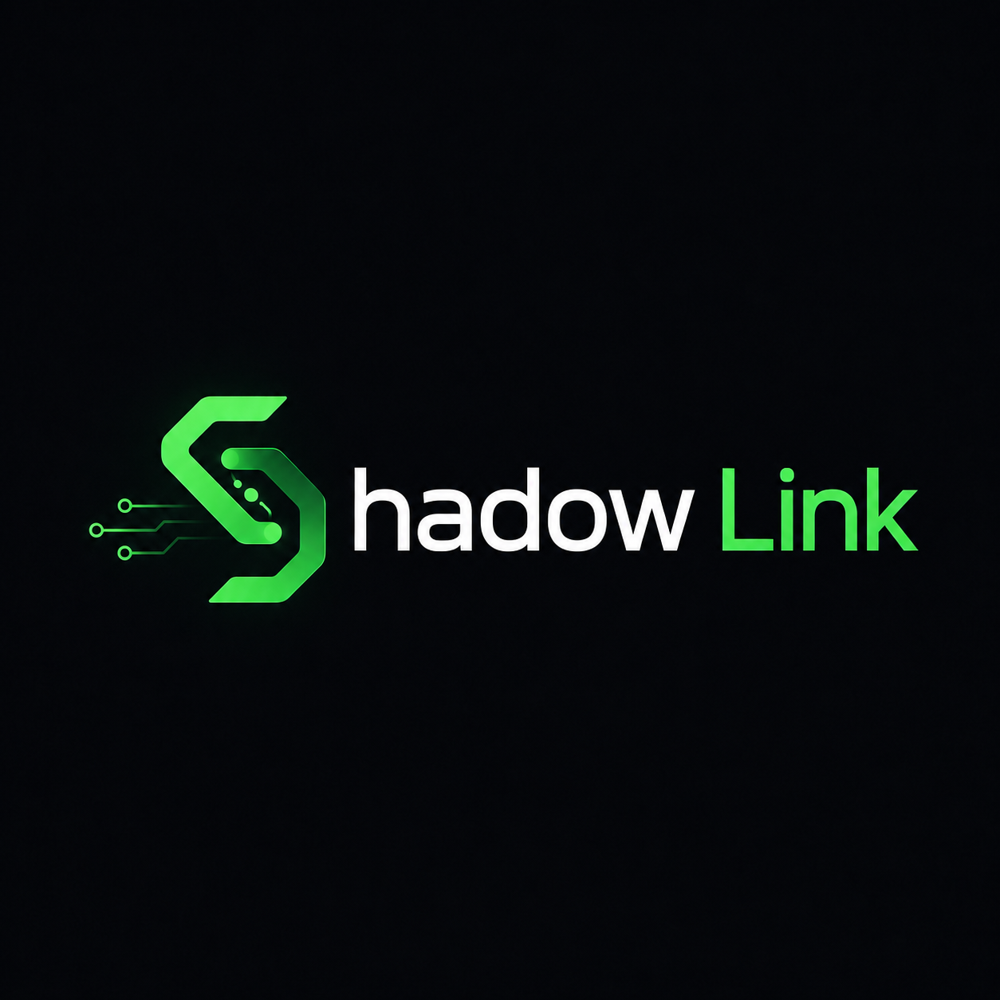

# Shadow Link v3

<p align="center">
  
</p>

<p align="center">
  <strong>The shadow of you.</strong><br>
  Local. Terminal-native. Operator-controlled.<br><br>
  <a href="https://github.com/ThatReid23/Shadow-Link-v3">Repository</a> ·
  <a href="https://github.com/ThatReid23/Shadow-Link-v3/issues">Issues</a>
</p>

A local, terminal-native cognitive mirror for AI coding workflows.

Shadow Link learns situation → reply pairs from your past AI conversations, predicts how you are likely to respond, and surfaces those predictions as editable "ghost" replies. It includes a polished terminal UI, live Claude Code session mirroring, an MCP server, file watchers, and an optional Claude Code proxy.

## Disclaimer

Shadow Link can read local conversation history and, when proxy mode is enabled, decrypt Claude Code traffic through mitmproxy. Review the configuration before running it, keep the daemon bound to localhost, and use it at your own risk.

This is a personal workflow tool. Predictions are suggestions—not authorization to take actions on your behalf.

## Install

Requires Python 3.10+.

Clone and install:

```powershell
git clone https://github.com/ThatReid23/Shadow-Link-v3.git
cd Shadow-Link-v3
python -m venv .venv
.\.venv\Scripts\Activate.ps1
pip install -e .
```

This installs the `shadow-link` command.

On Windows, if mitmproxy fails to install:

```powershell
pip install --only-binary :all: mitmproxy
```

## Quick start

Start the daemon in one terminal:

```powershell
shadow-link daemon
```

Open the TUI in another:

```powershell
shadow-link ui
```

Type `/` to open the command palette. Use `/claude-shadow` for the full-screen Claude Code mirror.

To bootstrap the memory corpus from a Claude.ai export:

```powershell
shadow-link ingest-claude-export path\to\conversations.json
```

## CLI commands

| Command | What it does |
|---|---|
| `shadow-link ui` | Open the connected terminal UI. |
| `shadow-link daemon` | Start the local API and live transcript watcher. |
| `shadow-link daemon --proxy` | Start the daemon and managed Claude Code proxy. |
| `shadow-link stats` | Show corpus and bucket counts. |
| `shadow-link query <text>` | Search stored replies. |
| `shadow-link interactive` | Run the fast-reply simulator. |
| `shadow-link ingest-claude-export <file>` | Import reaction pairs from a Claude.ai export. |
| `shadow-link ingest-jsonl <file>` | Import an OGI/oneiros trace log. |
| `shadow-link ingest-human <dir>` | Import paired question/response files. |
| `shadow-link ingest-md <file>` | Import a Markdown prompt log. |
| `shadow-link watch <dir>` | Watch for question files and write ghost/response files. |
| `shadow-link run <command...>` | Wrap another CLI with inline ghost suggestions. |
| `shadow-link proxy` | Run the mitmproxy addon in the foreground. |
| `shadow-link mcp` | Run the stdio MCP server. |
| `shadow-link clear` | Clear the corpus after confirmation. |
| `shadow-link --help` | Show CLI help. |

## TUI commands

Type `/` in `shadow-link ui` to open the themed command palette.

| Command | What it does |
|---|---|
| `/status` | Show daemon, models, watcher, proxy, and corpus health. |
| `/stats` | Show corpus, graph, bucket, decay, and weight statistics. |
| `/query <text>` | Search stored reply text. |
| `/predict <situation>` | Predict your likely response. Plain text does the same thing. |
| `/ingest <situation> \| <reply>` | Teach a situation → reply pair. |
| `/pairs [count]` | Browse recent learned pairs. |
| `/live` | Show watcher state, the active ghost, and recent activity. |
| `/claude-shadow` | Open the animated full-screen Claude Code mirror. |
| `/proxy status` | Show proxy state. |
| `/proxy start [port]` | Start the managed proxy. |
| `/proxy stop` | Stop the managed proxy. |
| `/proxy view [count]` | Show recent proxy traffic and token usage. |
| `/proxy setup [port]` | Start the proxy and create `claude-proxy.ps1`. |
| `/accept [id]` | Use and reinforce a ghost. |
| `/reject [id]` | Reject and down-weight a ghost. |
| `/edit <text>` | Approve a ghost after reshaping it. |
| `/fix <text>` | Reject a ghost and store your correction. |
| `/refresh` | Reconnect to the daemon. |
| `/clear` | Clear the terminal. |
| `/help` | Show the command guide. |
| `/exit`, `/quit` | Exit the TUI. |

Inside `/claude-shadow`:

| Key | Action |
|---|---|
| `a` / `r` | Accept or reject the selected ghost. |
| `e` / `f` | Edit or correct the selected ghost. |
| `n` / `p` | Cycle through ghost alternatives. |
| `s` | Switch Claude Code sessions. |
| `V` | Toggle the full Claude response viewer. |
| `P` | Start or stop the proxy. |
| `q` | Return to the main TUI. |

## Claude Code proxy

The optional proxy injects relevant memories, captures reaction pairs, and records local request/usage audit data.

Easiest setup:

```text
/proxy setup
```

Then run the generated PowerShell launcher:

```powershell
& .\claude-proxy.ps1
```

Manual setup:

```powershell
$env:HTTPS_PROXY = "http://127.0.0.1:8080"
$env:NODE_EXTRA_CA_CERTS = "$HOME\.mitmproxy\mitmproxy-ca-cert.pem"
$env:NO_PROXY = "localhost,127.0.0.1,::1"
claude
```

The proxy only targets Anthropic message requests carrying the `claude-cli` user agent.

## Configuration

Create `config.json` in the project root. Environment variables override JSON values.

Minimal local configuration:

```json
{
  "database": { "path": "shadow_link.db" },
  "embeddings": {
    "server_url": "http://localhost:1235/v1/embeddings",
    "model": "",
    "provider": "lmstudio",
    "use_on_hot_path": false
  },
  "chat": {
    "server_url": "http://localhost:1234/v1/chat/completions",
    "model": "local-model",
    "lm_mode": true
  },
  "server": { "host": "localhost", "port": 5000 },
  "proxy": {
    "daemon_url": "http://localhost:5000",
    "port": 8080,
    "inject_nudges": true,
    "learn": true
  }
}
```

Set `SHADOW_LM_MODE=0` to disable generated replies and use retrieval only. Set `SHADOW_QUERY_EMBED=1` to enable semantic embeddings on prediction paths.

The included `embed_server.py` requires `torch` and `transformers`:

```powershell
pip install torch transformers
python embed_server.py
```

You can also point Shadow Link at LM Studio, Ollama, llama.cpp, or another OpenAI-compatible local endpoint.

## MCP tools

Run the server with:

```powershell
shadow-link mcp
```

It exposes:

- `shadow_log` — store a reaction pair.
- `shadow_query` — search stored replies.
- `shadow_nudge` — retrieve behavioral reminders.
- `shadow_draft` — predict a likely reply.
- `shadow_accept` — reinforce a used prediction.
- `shadow_stats` — inspect corpus health.

## API

`shadow-link daemon` starts the JSON API at `http://localhost:5000` by default. The TUI, proxy, watcher, and external agents use this API for predictions, feedback, ingestion, live state, and proxy control.

The API has no authentication and uses permissive CORS. Do not expose it to other machines or untrusted browser content.

## Testing

```powershell
python tests\test_full.py
```

The suite covers the matcher, database, MCP server, capture hook, subprocess wrapper, proxy optimizer, API, and TUI.

## Notes

- Local data is stored in `shadow_link.db`.
- Proxy audit logs are stored in `claude_audit/`.
- Embeddings and chat inference are local unless you configure remote endpoints.
- The project is primarily developed for Windows Terminal and PowerShell.
- Architecture details: [`docs/architecture.md`](docs/architecture.md).
- Build blueprint: [`docs/SHADOW_LINK_BUILD_BLUEPRINT.md`](docs/SHADOW_LINK_BUILD_BLUEPRINT.md).

## License

MIT — see [LICENSE](LICENSE).

Repository: [github.com/ThatReid23/Shadow-Link-v3](https://github.com/ThatReid23/Shadow-Link-v3)  
Issues: [github.com/ThatReid23/Shadow-Link-v3/issues](https://github.com/ThatReid23/Shadow-Link-v3/issues)
